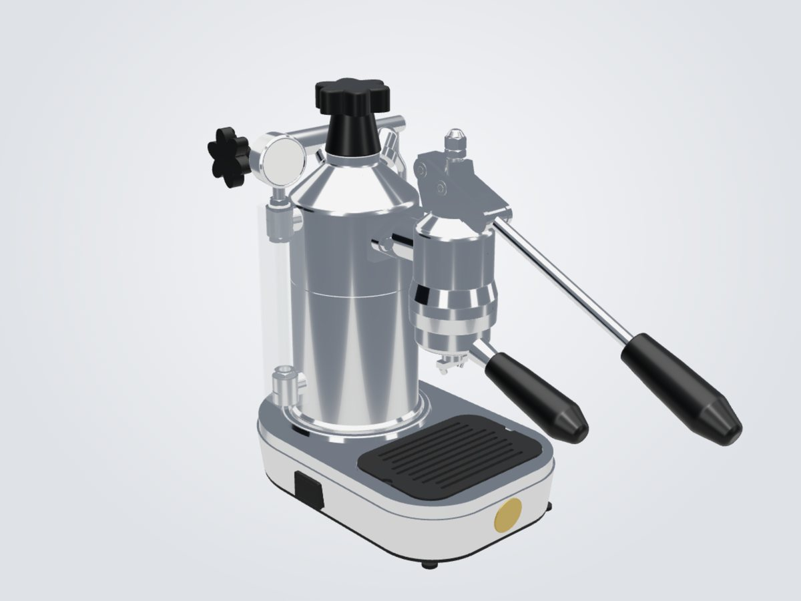
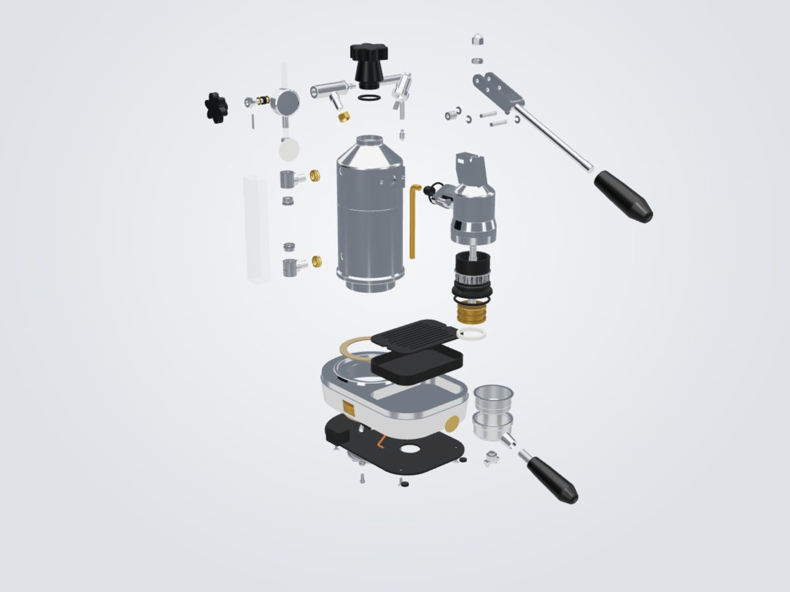
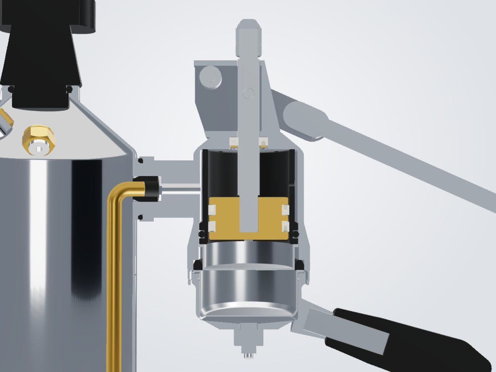

# La Pavoni Professional – zerlegbares 3D-Modell

Ein parametrisches 3D-Modell der Handhebel-Espressomaschine **La Pavoni Professional (Millennium-Gruppe)** als
Web-App: drehen, explodieren, aufschneiden, Teile ausbauen und Reparatur-Anleitungen Schritt für Schritt
abspielen. Gedacht als Sehhilfe beim Dichtungswechsel – wo sitzt die Dichtung, wie herum, was muss vorher ab.

| Gesamtansicht | Explosionsansicht | Schnitt durch die Gruppe |
|---|---|---|
|  |  |  |

Eigene Renderings aus dem Modell (`make renders`).

> **Sehhilfe, kein Ersatz für Fachkenntnis.** Viele Maße sind geschätzt (siehe unten) und in der App als
> solche markiert. Arbeiten an Netzspannung und Druckkessel nur stromlos, kalt, drucklos und entleert.

Verbindliche Spezifikation: [`PLAN.md`](PLAN.md) (Umsetzungsnotizen und Abweichungen in Abschnitt 16).
Kurzregeln für Beiträge: [`CLAUDE.md`](CLAUDE.md). Quellen: [`reference/SOURCES.md`](reference/SOURCES.md).

## Was die App kann

| Funktion | Bedienung |
|---|---|
| Teil auswählen | Klick ins Modell oder in den Baum (links). Rechts: Name, Position, Maße mit Konfidenz, Bestellbegriffe, Gewinde |
| Explosionsansicht | Regler „Explosion“ in der Werkzeugleiste – Baugruppen fahren stufenweise entlang ihrer Ausbaurichtung |
| Schnitt | Auswahl „Kein Schnitt“ öffnen – zwölf Voreinstellungen (Gruppe, Kolbendichtungen, Stangendichtung, Schauglas, Dampfhahn, Sicherheitsventil, Kesselboden …) mit gefüllten Schnittflächen; Regler daneben verschiebt die Ebene |
| Dichtungs-Karte | Knopf „Dichtungen“ – alle Dichtungen farbig, Liste mit Nennmaß, schwächster Konfidenz und Bestellbegriff |
| Zerlegen | Beim gewählten Teil „Ausbauen zeigen“ – die App berechnet, was vorher ab muss, und baut es der Reihe nach aus |
| Anleitungen | Elf Reparatur-Anleitungen (Liste rechts), vorwärts als Zerlegen, rückwärts als Zusammenbauen, mit Werkzeug, Ersatzteilen, Warnungen und Einbauhinweisen |
| Tastatur | ← / → Schritt zurück/weiter (Anleitung, Zerlegen), Esc schließt den Modus bzw. hebt die Auswahl auf |
| Handy | Hochformat-Layout, Baum eingeklappt, Touch-Gesten (ein Finger drehen, zwei zoomen/verschieben) |

Die elf Anleitungen: Kolbendichtungen · Siebträger-Dichtung und Duschsieb · Kolbenstangen-Dichtung ·
Schauglas-Dichtungen · Dichtung Gruppe/Kessel · Dampfhahn-Dichtungen · Kesseldeckel-Dichtung ·
Sicherheitsventil · Heizelement-Dichtung · Basisdichtungen · Komplettzerlegung.

### Deep-Links

Der Zustand steht in der Adresse und lässt sich teilen, z. B.
`?proc=piston_seals&step=9` (Anleitung, Schritt 9) oder `?part=p080_piston_seal&section=piston_seals`.

| Parameter | Bedeutung |
|---|---|
| `part=<id>` | Teil auswählen (IDs wie in `data/parts.yaml`) |
| `proc=<id>&step=<n>&dir=assemble` | Anleitung öffnen, Schritt `n` (ab 1), optional Zusammenbau-Richtung |
| `view=<name>` | Kameraansicht aus `data/views.yaml` |
| `explode=<0..1>` | Explosionsgrad |
| `seals=1` | Dichtungs-Karte |
| `section=<name>` | Schnitt aus `data/views.yaml` |
| `ui=0`, `bg=transparent`, `anim=0`, `quality=low` | für Renderings: ohne Bedienelemente, transparenter Hintergrund, ohne Animation, Software-Rendering |

## Bauen

Voraussetzungen: Linux oder macOS, `make`, [`uv`](https://docs.astral.sh/uv/) (holt Python 3.13), Node.js 22.

```sh
make setup      # Python-venv (cad/.venv) und npm-Abhängigkeiten
make cad        # build123d -> build/pavoni_raw.glb, pavoni.step, manifest.json -> web/public/models/pavoni.glb
make validate   # Prüfungen nach PLAN 11.1 -> build/validation_report.json
make web        # YAML -> web/src/generated/data.json, Typecheck, Vite-Build -> web/dist
make test       # pytest, vitest, oxlint, Playwright-E2E
make renders    # feste Ansichten und Schnitte -> artifacts/renders/*.png
make overlay    # Renderings über die Referenzfotos -> artifacts/overlays/
make all        # cad, validate, web, test, renders
```

Lokal ansehen: `cd web && npx vite preview` (nach `make cad web`) oder `npm run dev`.
Das gebaute `web/dist` ist eine statische Seite mit relativen Pfaden und läuft auf jedem Webserver.

Ein voller Bau (`make cad`) dauert einige Minuten, `make validate` mit Kollisionsprüfung aller Ausbauwege
und Anleitungsschritte etwa 20 s.

## Aufbau

```
data/                 Quelle der Wahrheit (YAML + JSON-Schema)
  dimensions.yaml     jedes Maß mit Quelle und Konfidenz; Foto-Maße als Verhältnis zum Kesseldurchmesser
  parts.yaml          Stückliste: ID, Baugruppe, Werkstoff, Verschleißteil, Ausbau-Voraussetzungen, Bestellbegriffe
  assemblies.yaml     Baugruppenbaum mit Ausbaurichtung
  procedures/*.yaml   die elf Anleitungen
  views.yaml          Kameraansichten und Schnitte
  overlaps.yaml       erlaubte Überdeckungen (gequetschte Dichtungen) mit Begründung
cad/pavoni/           build123d-Modell: datums.py (Skelett), parts/*.py (je Baugruppe), export.py, validate.py
web/                  Vite + React + React Three Fiber
scripts/              Renderings und Foto-Overlays (Playwright)
reference/            SOURCES.md (nur Links), measurements.md (Mess-Checkliste), photos/README.md
```

Regeln, die das Modell zusammenhalten: Teile-ID = CAD-Label = GLB-Knoten = Eintrag in `parts.yaml`;
kein Maß im CAD-Code; ein reales Teil = ein Solid; Dichtungen in Nennmaß mit Nut im Gegenstück.
`make validate` prüft u. a. Stückliste ↔ GLB, gültige Solids, Durchdringungen (außer begründeten
Dichtungs-Quetschungen), kollisionsfreie Ausbauwege, Hüllmaß, Budgets, Anleitungen und die Proportionen
aus den Fotos.

## Stand und Genauigkeit

- 100 Positionen, davon 92 modelliert (8 optionale Zubehörteile bewusst nicht). Status je Teil in
  `data/parts.yaml`: `verified` = Sitz und Einbaurichtung im Schnitt gegen Quellen geprüft bzw. Außenform im
  Foto-Overlay, `modeled` = plausibel, aber im Detail ohne Beleg.
- 227 Maße: 111 aus Händlerkatalogen, 61 aus Fotoproportionen, 52 geschätzt, 3 aus Herstellerangaben,
  **0 gemessen**. Der Kesseldurchmesser (104 mm) ist aus Fotos und Katalogteilen hergeleitet und skaliert
  alle Foto-Maße.
- Dichtungsmaße stammen aus Händlerkatalogen (Nennmaße), nicht aus Messungen an dieser Maschine.
- Was eine Messung am meisten verbessert, steht geordnet in
  [`reference/measurements.md`](reference/measurements.md). Messwert in `data/dimensions.yaml` eintragen
  (`confidence: measured`, `source: "Messung Besitzer, <Datum>"`), dann `make cad validate web renders`.

## Rechtliches

Eigenes Modell nach öffentlich zugänglichen Angaben. Das Repo enthält keine fremden Bilder oder
Zeichnungen; Referenzfotos und Explosionszeichnungen sind nur verlinkt. „La Pavoni“ ist eine Marke ihres
Inhabers; dieses Projekt steht in keiner Verbindung zum Hersteller.
